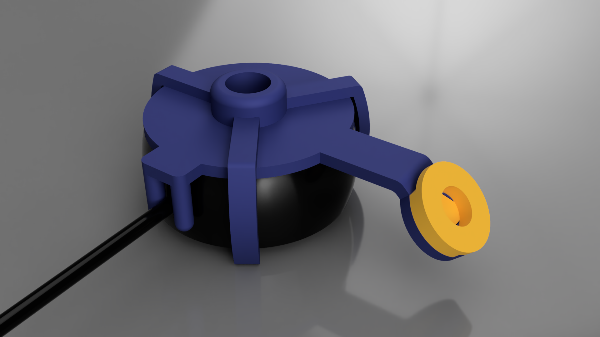
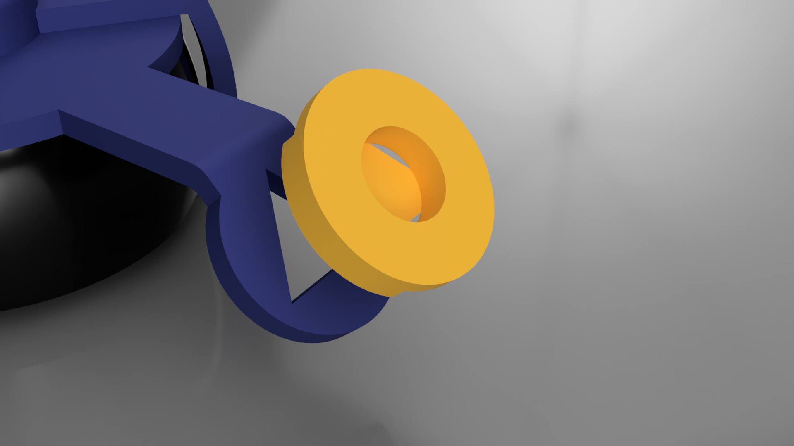
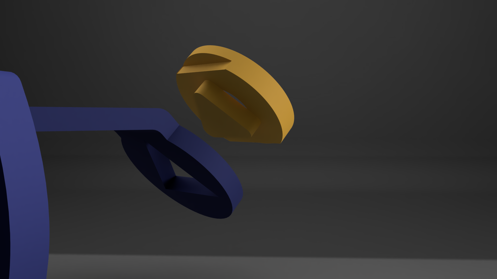
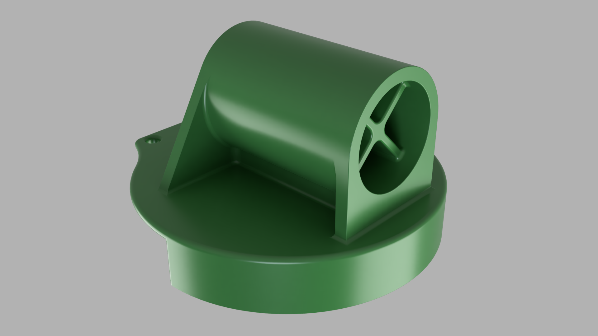

# tFUS Precision Adapters
In this repository we provide templates for custom-made adapters that can be 3D printed and used in transcranial focused ultrasound stimulation (tFUS) research to improve sonication accuracy and facilitate precise single-element transducer placement during functional magnetic resonance imaging (fMRI). Utilizing both a mount for the transducer (for the transducer tracker) and a dental splint (for the subject tracker) allows flexible de- and reattachment of the trackers before and after a fMRI session, while still maintaining steady reference points. This ultimately helps to validate and document the position of the tFUS transducer during neuromodulation.

## Mounts for the Transducer Tracker
We provide models for two frequently used ultrasound devices in tFUS research:

### BrainSonix
This mount is designed the BX Pulsar 1001 ultrasound device (BrainSonix Corporation, LA, California, USA) and is attached via a single screw on the top of the transducer.

- Mount with detachable tracker socket _(brainsonix-mount_tm-v10d_model [.stl] [.f3d])_

### NeuroFUS
This mount is designed for the NeuroFUS PRO ultrasound system (Brainbox Ltd, Cardiff, UK), which can be simply slid onto the back of the transducer.

- Mount with detachable tracker socket _(neuroFUS-mount_tm-v1_model [.stl])_

Alternative Version:
- Mount with an attachment for a metal pincer _(neuroFUS-mount_tm-pincer-v2.2_holder-mount [.stl])_

## Dental Splints for the Subject Tracker
For the subject tracker, we provide a mount that attaches to a dental splint by DenTek Maximum Protection Dental Guards (Ceuta Healthcare, Bournemouth, UK, [URL: https://dentek-eu.com/protect/maximum-protection-dental-guards/]). The dental guard needs to be fitted individually for each subject. The mount can then be securely attached to the guard. As long as the participant bites down on the splint, the jaw provides a reliable reference point, even after removing and reintroducing the splint.

- Mount for dental splint _(dental-splint_ds-v6 [.stl] [.f3d])_

## 3D Models
The 3D models are uploaded in _.stl_ and _.f3d_ format. The latter is the native format of the 3D-modeling software Fusion360 (Autodesk Inc., San Francisco, California, USA). With this free software, adjustments to the models can be made to fit any given conditions (e.g. reduce or increase the diameter of the tracker sockets).

## 3D Printing
On our models, the plugs for the detachable tracker mounts are 0.2 mm smaller than the corresponding socket. The optimal tolerance for those parts to fit neatly together greatly depends on the specific 3D printer and fiber used. Therefore, we provide a set of plug-models varying in tolerance from 0 to 0.2 mm.

## Contributors
Tobias Daniel Trieb (E-mail: triebt00@univie.ac.at)
Franz Roman Schmid
Elias Vogtenhuber

We are not affiliated with manufacturers or distributors of tFUS transducer devices.
