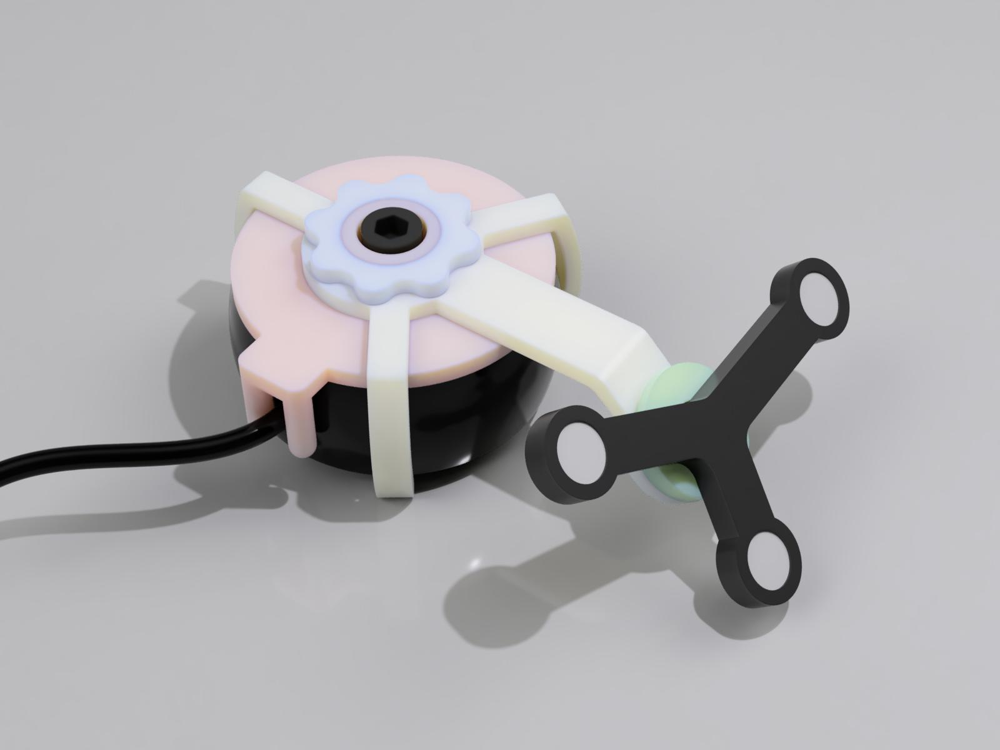
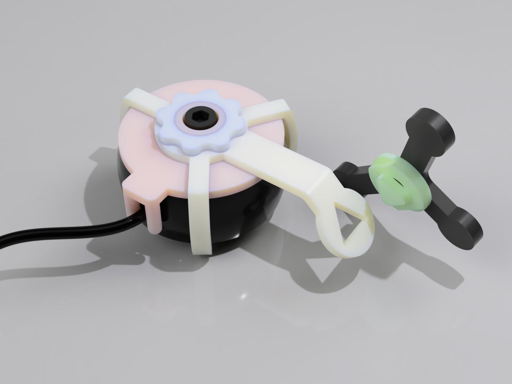
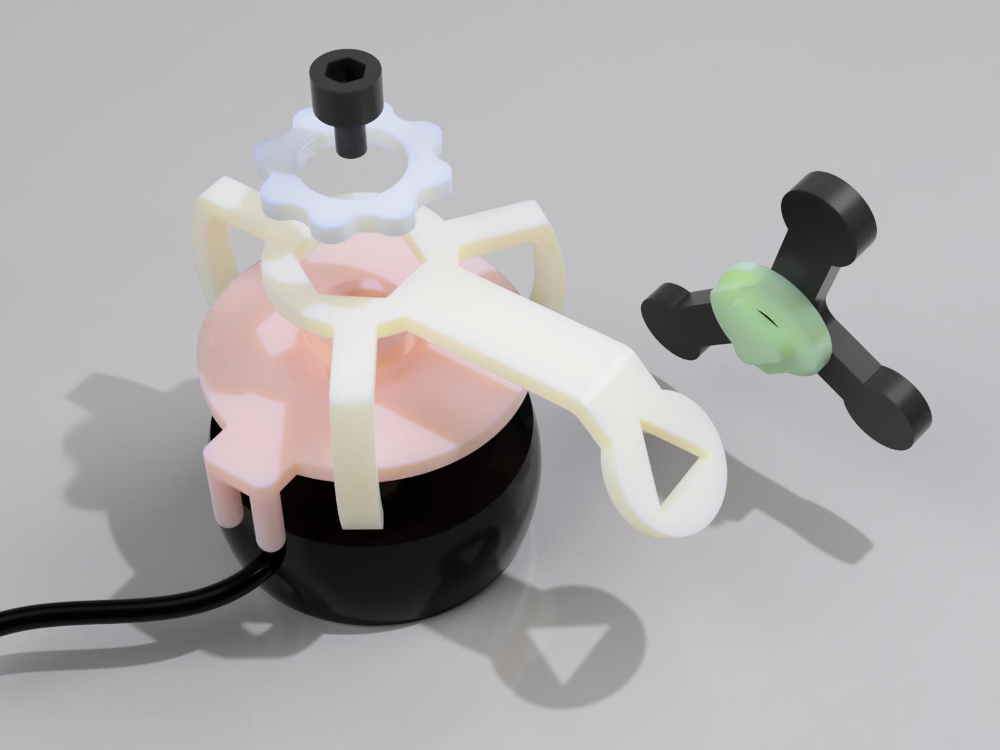
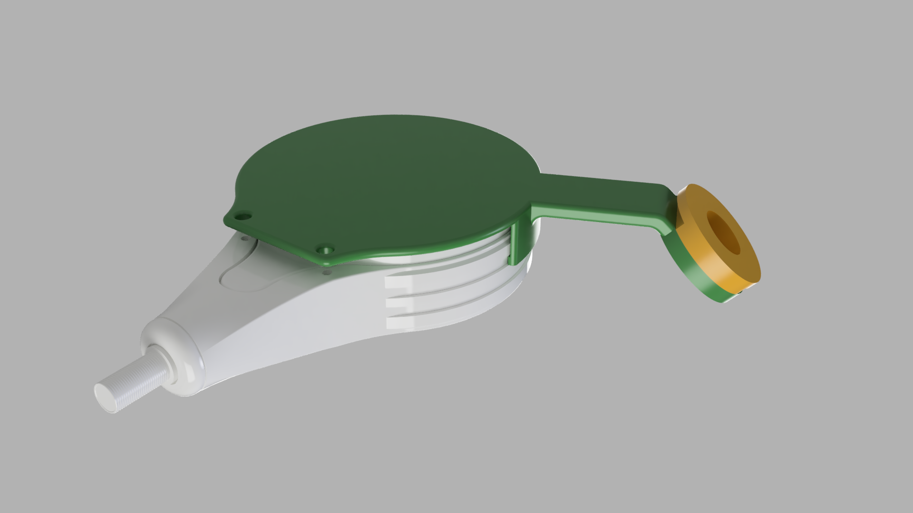

# tFUS Precision Adapters
In this repository we provide templates for custom-made adapters that can be 3D printed and used in transcranial focused ultrasound stimulation (tFUS) research to improve the accuracy of sonication with single-element transducers during functional magnetic resonance imaging (fMRI).

## Why Use Adapters?

In many experimental setups, perfect precision over the entire sonication duration is not realistically achievable. This is especially true when tFUS is combined with fMRI. Without fMRI, neuronavigation can be used to monitor the deviation throughout the stimulation period. This allows us to continuously adjust the device, if necessary. However, it is extremely difficult to perform neuronavigation in the fMRI environment using basic equipment. This means that the tFUS device has to be affixed to the participant’s head before they enter the scanner, while maintaining minimal deviation from the planned placement. Any change in the tFUS device's position during the sonication due to the participant’s movement or gravity cannot be mitigated.

With these adapters, we aim to facilitate precise transducer placement, while performing neuronavigation with 3D motion tracking. Utilizing both a mount for the transducer and a dental splint for the participant allows for the flexible de- and reattachment of the associated motion tracker before and after a fMRI session, while still maintaining steady reference points for the transducer and the participant's head. This ultimately helps to validate the position of the tFUS transducer during neuromodulation and allows us to document the achieved precision at multiple points in time.

## Mounts for the Transducer Tracker
We provide adapter models for two frequently used ultrasound transducers in experimental tFUS research:

### BrainSonix
- Mount with detachable tracker socket and changeable arm angle _(brainsonix-mount_tm-v12uni_model [.stl] [.f3d])_

This mount is designed for the BX Pulsar 1001 ultrasound device (BrainSonix Corporation, LA, California, USA) and is attached via a single screw (part of the device) or with tape on the top of the transducer. The angle of the arm, relative to the transducer cable, can be changed at 60 degree intervals. The three pincers were added to minimize the risk of the gel pad sliding from under the transducer. During neuroimaging, the plug can be removed, while the rest of the adapter stays on the transducer. Afterwards, it can be reattached at the same place.

### NeuroFUS
- Mount with detachable tracker socket _(neuroFUS-mount_tm-v1_model [.stl])_

Alternative Version:
- Mount with an attachment for a metal pincer _(neuroFUS-mount_tm-pincer-v2.2_holder-mount [.stl])_

This mount is designed for the NeuroFUS PRO ultrasound system (Brainbox Ltd, Cardiff, UK), which can be simply slid onto the back of the transducer. The alternate version can be used outside of the fMRI scanner with a pincer.

## Dental Splints for the Subject Tracker
- Mount for dental splint _(dental-splint_ds-v6 [.stl] [.f3d])_

For the subject tracker, we provide a mount that attaches to a dental splint by DenTek Maximum Protection Dental Guards (Ceuta Healthcare, Bournemouth, UK, [URL: https://dentek-eu.com/protect/maximum-protection-dental-guards/]). The dental guard needs to be fitted individually for each participant. The adapter can then be securely attached to the dental guard. As long as the participant bites down on the splint, the jaw provides a reliable reference point, even after removing and reintroducing the splint.

## 3D Models
The 3D models are uploaded in _.stl_ and _.f3d_ format. The latter is the native format of the 3D-modeling software Fusion360 (Autodesk Inc., San Francisco, California, USA). With this free software, adjustments to the models can be made to fit any given conditions (e.g. reduce or increase the diameter of the tracker sockets).

## 3D Printing
On our models, the plugs for the detachable tracker mounts are 0.2 mm smaller than the corresponding socket. The optimal tolerance for those parts to fit neatly together greatly depends on the specific 3D printer and fiber used. Therefore, we provide a set of plug-models varying in tolerance from 0 to 0.2 mm.

## Contributors
- Tobias Daniel Trieb (E-mail: triebt00@univie.ac.at)
- Franz Roman Schmid
- Elias Vogtenhuber
